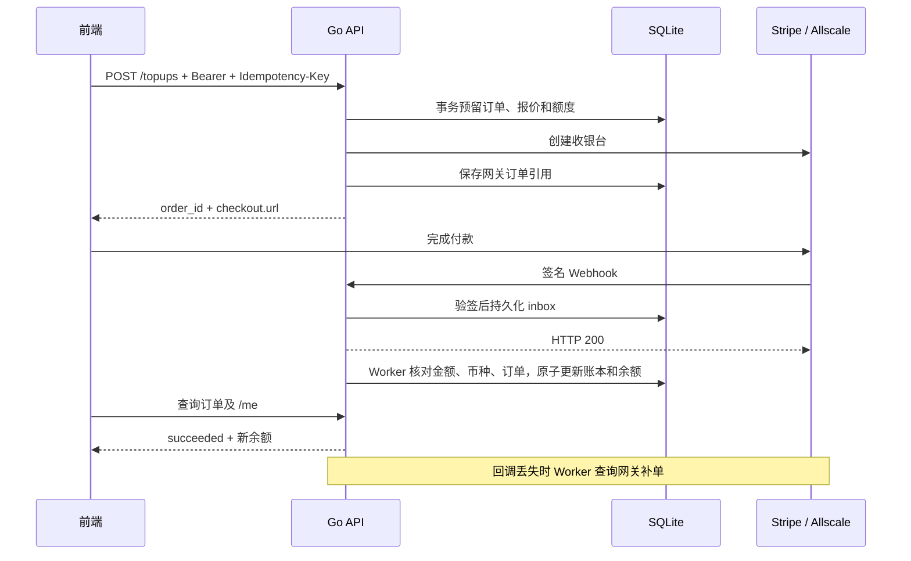

# Pay — Go Stripe & Allscale Payment Demo

Go 支付后端教学项目：Stripe Checkout 信用卡储值、Allscale 稳定币收银台、SQLite 订单与点数账本、Webhook 验签、幂等入账和自动对账。包含可在桌面与移动端操作的本地演示页面。

参考既有前端的储值接口契约独立实现，未复制其业务代码。默认演示不连接支付平台、不扣款；真实网关适配器已实现，但尚未使用商户凭据做真实联调。

## 快速启动

需要 Go 1.23+（验证环境 Go 1.25.11），无需 Node 或外部数据库。

```sh
HTTP_ADDR=127.0.0.1:8098 PUBLIC_URL=http://127.0.0.1:8098 go run ./cmd/server
```

打开 <http://127.0.0.1:8098>，选择方案 → Stripe 或 Allscale → 模拟付款成功 → 查看订单及余额。勾选「模拟回调丢失」后，等待后台约 30 秒轮询补单。可模拟失败、过期、确认中和人工复核。本地演示用户固定为 `demo-user`，重启后保留订单与余额。

```sh
make test   # race 测试与 vet
make build  # bin/pay，内嵌网页
```

浏览器回归：启动使用全新 `DATABASE_PATH` 的 demo 服务后，执行 `npm ci && npx playwright install chromium && npm run test:e2e`。默认访问8098端口，可通过 `PAY_BASE_URL` 覆盖；测试会模拟付款写入演示数据，截图输出到忽略的 `test-results/`。

配置见 [.env.example](.env.example)。程序读取进程环境变量，不自动读取 `.env`。默认数据库 `data/pay.db`，已被 Git 忽略。开发 token 工具：`go run ./cmd/token -user alice -role user`，有效期一小时；仅供受信任服务端签发，勿暴露为公共接口。

## 两条完整储值链路

| 方式 | 创建支付 | 确认与入账 | 异常处理 |
| --- | --- | --- | --- |
| Stripe | 服务端固定价格，创建 hosted / embedded Checkout Session | 验签回调或查询 Session，`payment_status=paid` 后原子入账 | 重复通知去重，超时恢复原幂等请求，全额退款回调冲回点数 |
| Allscale | 固定汇率将 TWD 订单转为 USD 报价，创建 Checkout Intent | HMAC 验签成功通知或查询详情，状态 20 后入账 | 确认中继续轮询，少付转复核，建单结果未知不盲目重建 |

USDT / USDC 和 EVM 网络由 Allscale 收银台实际可用项决定，项目不承诺固定链列表。公开币种表没有 TWD，故使用 `currency=1`（USD）和 `ALLSCALE_TWD_PER_USD`。例如 NT$1000、汇率32，支付报价为3125美分。金额采用整数及有理数计算，换汇向上取整到美分，报价随订单冻结。



浏览器回跳、客户端传入的成功状态、交易哈希都不能触发到账。每笔订单最多产生一条 credit 和一条全额 refund 账本记录。用户不能查询或操作他人的订单。

## 接口

除 plans、healthz、签名 webhook 外，业务接口要求 Bearer JWT。角色与用户来自验证后的 token，禁止请求体指定付款归属。HS256 校验 issuer、audience、exp，guest 禁止储值，管理接口要求 admin。

| 方法与路径 | 用途 |
| --- | --- |
| GET `/topup/plans` | 服务端套餐、启用通道、自定义金额规则 |
| POST `/topups` | 创建/幂等重放，必须传 `Idempotency-Key` |
| GET `/topups?status=&limit=20` | 当前用户订单，最多100条 |
| GET `/topups/{id}` | 订单、到账点数、加密支付详情 |
| GET `/topups/pending` | 最新可付款订单，空结果204 |
| POST `/topups/{id}/resume` | 查询并恢复 Stripe 收银台 |
| POST `/topups/{id}/cancel-hint` | 仅隐藏恢复提示，不撤销支付 |
| GET `/me`、`/me/ledger` | 点数余额、最近100条账本 |
| POST `/webhooks/stripe`、`/webhooks/allscale` | 两家网关验签通知 |
| GET `/admin/reconciliation` | 未处理事件、未知建单、复核订单、余额差异统计 |
| POST `/admin/reconcile` | 触发一次后台处理 |
| POST `/admin/orders/{id}/attach` | 人工找回未知建单引用，服务端重新查询验证后绑定 |
| GET `/healthz` | 数据库连接健康检查 |

```sh
curl http://127.0.0.1:8098/topups \
  -H "Authorization: Bearer $PAY_TOKEN" \
  -H 'Content-Type: application/json' \
  -H 'Idempotency-Key: purchase-example-001' \
  -d '{"plan_id":"demo-1000","gateway":"stripe","ui_mode":"hosted"}'
```

金额可选 `plan_id` 或 `amount_nt`，互斥。自定义金额默认关闭，启用后范围51000–500000 TWD、步进1000、每 TWD 2.4点。默认每日额度100000 TWD，包含待付预留，按台北自然日计算。同一购买意图重试必须复用原键；同键不同参数返回409。创建结果未知时保留返回的 `order_id`，不要立即换键重复购买。

更多联调、错误恢复和参考前端差异见 [接入与运维](docs/integration.md)。

## 代码结构

```text
cmd/server       HTTP 服务、定时对账、优雅退出
cmd/token        本地/受信任服务端 token 工具
internal/auth    JWT 验证
internal/config  环境变量与套餐校验
internal/httpapi 路由、权限、限流、CORS、演示接口
internal/service 业务报价、创建与后台编排
internal/payment Stripe / Allscale 协议和本地模拟器
internal/store   SQLite 事务、inbox、账本、订单和额度
web              内嵌响应式页面
```

## 验证范围与边界

测试覆盖双通道生命周期、并发幂等、重复/乱序通知、伪造签名、金额不符、跨用户访问、访客权限、回调丢失恢复、重启持久化、退款冲回与固定汇率。真实适配器通过本地 HTTP mock 验证协议，Allscale 签名另有独立 golden vector。

这是可运行的单实例支付参考实现，生产上线仍需商户联调及运营验收。SQLite 与进程内限流面向单实例；多实例需共享事务数据库、分布式限流和任务协调。未实现消费扣点、自动退款发起、拒付处理、Allscale 出款、会员与营销业务；不应作为这些功能已完成的证明。

## 协议来源

- [Stripe Checkout fulfillment](https://docs.stripe.com/checkout/fulfillment)，REST 版本固定为 `2024-06-20`。
- [Allscale 官方集成说明](https://github.com/allscale-io/allscale-checkout-skill/blob/318bc701ad681f41ca0b96d4f59fad1729fae344/.claude/commands/integrate-allscale.md)。
- [Allscale 官方 WooCommerce 插件协议参照](https://github.com/allscale-io/allscale-wordpress-plugin/tree/a661c1a1539697b175f1643782d8d15c5bf58cc2)，仅用于核对字段和状态，未复制插件实现。

关键词：Golang payment gateway, Stripe Checkout, Allscale, stablecoin payments, USDT, USDC, EVM, webhook verification, idempotency, SQLite ledger, wallet top-up.
